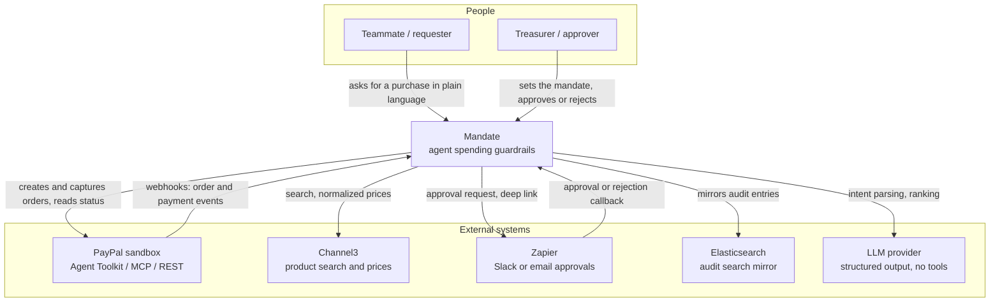
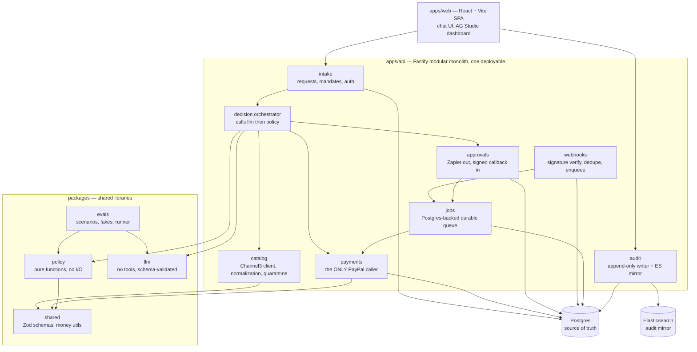
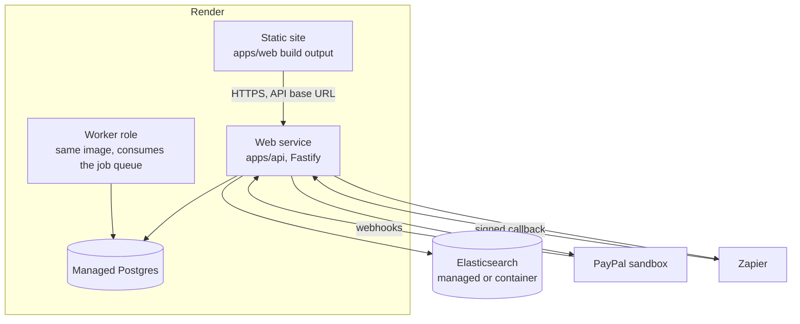

# Architecture: Mandate

Mandate is one deployable API (a modular monolith) with strict internal module boundaries, a separate React SPA, a pure policy package, and durable background handling for approvals and webhooks.
The architecture exists to enforce one invariant: **the LLM proposes, code decides** — no model output ever moves money directly, and untrusted retailer text never reaches a context that holds tools.
This document covers system context, containers, trust boundaries, the architecture-style decision, failure modes, security and deployment.

**Related:** [README](../README.md) · [UML diagrams](uml.md) · [ER diagram](er-diagram.md) · [tech stack](tech-stack.md) · [ADRs](adr/) · [idea proposal](Idea-propose-Anubhav.md)

> `VERIFY` marks anything we have not confirmed. Nothing marked `VERIFY` may be presented as fact.

---

## 1. System context

Who and what the system talks to.

| Actor / system | Interaction | Trust |
|---|---|---|
| Teammate (requester) | Natural-language purchase requests, sees decisions and reasons | Authenticated, low privilege |
| Treasurer / approver | Creates mandates, approves or rejects escalations | Authenticated, high privilege |
| PayPal sandbox | Order creation, capture, status, refunds, webhooks | Trusted integration, untrusted transport — webhook signatures verified |
| Channel3 | Product search, catalog prices | **Trusted for prices, untrusted for text** — see §3 |
| Zapier | Delivers approval requests, returns approval callbacks | Untrusted callback — must carry a signed, single-use token |
| Elasticsearch | Search over a mirror of the audit log | Derived store, never authoritative |
| LLM provider | Intent parsing and ranking only | Output is untrusted until schema-validated |

## 2. Containers and components

### Module responsibilities and rules

| Module | Owns | Hard rule |
|---|---|---|
| `intake` | Mandates, purchase requests, authentication, authorization | Validates every input at the HTTP boundary with Zod |
| `catalog` | Channel3 client, product normalization, price snapshots, text quarantine | Product text is truncated and delimited before it leaves this module |
| `decision orchestrator` | Sequences llm → policy → payments/approvals | Holds no business rules of its own |
| `payments` | PayPal order create, capture, status, refunds | **The only module with PayPal credentials.** Refuses to act without an `ALLOW` decision id or an approval id |
| `approvals` | Outbound Zapier notifications, inbound signed callbacks | Callback tokens are single-use and bound to one request |
| `webhooks` | Signature verification, dedupe by provider event id, enqueue | Never performs business logic inline; always enqueues |
| `audit` | Append-only audit entries, mirror to Elasticsearch | Write path only; no UPDATE or DELETE |
| `jobs` | Postgres-backed durable queue, retries, timeouts | At-least-once delivery; every consumer is idempotent |
| `packages/policy` | Budget, per-item cap, categories, threshold, structuring detection | **Pure.** No I/O, no clock, no randomness — time and state are passed in |
| `packages/llm` | Intent parsing, candidate ranking | **No tools, no payment credentials.** Output is schema-validated or rejected |
| `packages/shared` | Zod schemas, types, integer-minor-unit money utilities | Money is never a float |

## 3. Trust boundaries

The central security property: untrusted text can influence *what is proposed*, never *what is paid*.

```mermaid
flowchart LR
  subgraph untrusted["UNTRUSTED — attacker-controlled"]
    RT["Retailer and product text<br/>titles, descriptions, reviews"]
  end

  subgraph quarantine["QUARANTINE — catalog module"]
    QT["truncate, delimit, strip control chars<br/>tag as untrusted, never concatenated into instructions"]
  end

  subgraph proposal["PROPOSAL — packages/llm"]
    MODEL["LLM call with NO tools and NO credentials<br/>returns candidate ids and quantities only"]
    ZOD["Zod validation<br/>reject on any schema failure"]
  end

  subgraph decision["DECISION — packages/policy, pure code"]
    PRICE["recompute prices from normalized catalog data"]
    RULES["budget, per-item cap, category, threshold, structuring"]
    OUT["ALLOW / NEEDS_APPROVAL / DENY plus reasons"]
  end

  subgraph money["MONEY — payments module"]
    PAY["PayPal sandbox call with idempotency key"]
  end

  RT --> QT --> MODEL --> ZOD --> PRICE --> RULES --> OUT
  OUT -->|"ALLOW or recorded approval only"| PAY
  OUT -.->|"DENY or pending"| STOP["no money-moving call"]
```

| Boundary crossing | Control |
|---|---|
| Retailer text → LLM context | Truncate to a fixed length, delimit, strip control characters, label as untrusted data; the call has no tools |
| LLM output → application | Zod schema validation; ids must resolve to candidates we actually fetched; unknown ids rejected |
| LLM output → money | **Never direct.** Prices and totals are recomputed in code from `PRODUCT_SNAPSHOT` rows |
| Policy decision → PayPal | `payments` requires a persisted `ALLOW` decision id, or an `APPROVAL` row with status `APPROVED` |
| Zapier callback → approval | Signed, single-use token bound to one `PURCHASE_REQUEST`; expiry enforced server-side |
| PayPal webhook → state change | Signature verified, deduped by provider event id, then enqueued — never trusted inline |

## 4. Architecture style decision

### Decision

**A modular monolith**: one deployable Fastify API with strictly separated internal modules; **durable, event-driven background handling** (a Postgres-backed job queue) for approvals, webhook processing, retries and timeouts; a **separate SPA** deployed as a static site; and the **policy engine as a pure package** with no I/O.

Recorded as [ADR 0001](adr/0001-modular-monolith.md).

### Alternatives considered

| Option | Why not (for this team, this deadline) |
|---|---|
| **Microservices** (separate intake, policy, payments, approvals services) | Five people and 21 days. Every service boundary becomes a network boundary, and every network boundary adds partial-failure modes exactly where correctness matters most: money. A failed call between "policy allowed" and "payment captured" becomes a distributed-transaction problem we would have to solve with outboxes and sagas across repos, under deadline. The cost is paid immediately; the benefit (independent scaling, independent deploys) is worth nothing at hackathon scale |
| **Serverless functions** | Attractive for webhooks, but cold starts hurt a conversational flow, local development and the Gate 3 "stranger runs it from the README" test get harder, and durable multi-step approval flows need an external orchestrator anyway. Fragmenting business logic across function handlers also makes the audit trail harder to keep coherent |
| **Unstructured monolith** (no module boundaries) | Fastest to write, and fatal here. Our core claim is that payment authority is *structurally* confined to one module. Without enforced boundaries, a well-meaning teammate at 2 a.m. imports the PayPal client into the LLM path and the guardrail story quietly becomes untrue. The boundary *is* the product |
| **Agent framework** (LangChain/LangGraph-style tool-calling agent) | Directly contradicts hard rule 1. These frameworks are built around giving the model tools; we are building the opposite. We would spend our time constraining the framework rather than using it. A thin provider-agnostic wrapper with schema-validated structured output is smaller and auditable |
| **Render Workflows instead of a Postgres job queue** | A reasonable alternative and a sponsor-visible one. We default to the in-repo Postgres queue because it runs identically on a laptop with `docker compose up`, keeps job state in the same transaction boundary as order state, and has no second system to learn. See the dissent note in [tech-stack.md](tech-stack.md) |

### Why these boundaries, specifically

| Boundary | Reason it is a boundary rather than a convention |
|---|---|
| `packages/policy` is pure | Pure functions are exhaustively unit-testable without fixtures, mocks or a database. The eval suite can run thousands of policy cases in milliseconds, which is what makes the three-configuration measurement affordable |
| `packages/llm` has no tools | Enforced by dependency direction: the package does not depend on the PayPal client, so it cannot call it. This is checkable in CI, not just in review |
| `payments` is the only PayPal caller | One place to enforce idempotency keys, one place to audit, one place to review |
| SPA is separate | Static hosting, no server-side secrets in the browser bundle, independent deploy cadence for UI polish in the final week |

### When we would extract a service

We extract only on a concrete trigger, not on taste:

| Trigger | Extraction |
|---|---|
| Policy checks are sold as a standalone developer API with external customers and separate SLAs | Extract `packages/policy` behind a thin HTTP service — it is already pure, so this is a wrapper, not a rewrite |
| Webhook volume or eval runs starve the request path of CPU | Run the same deployable in a worker role consuming the job queue, before splitting codebases |
| A compliance requirement demands separate credential custody for payments | Extract `payments` with its own secret scope |

None of these apply before Nov 12.

## 5. Failure modes

Every row is a scenario the system must survive without losing money or lying in the audit log.

| # | Failure | Detection | Response | Invariant protected |
|---|---|---|---|---|
| 1 | **Duplicate webhooks** — the provider redelivers the same event | `webhook_event.provider_event_id` unique constraint | Insert attempt conflicts; event acknowledged, processing skipped | Each event applied at most once |
| 2 | **Out-of-order webhooks** — `CAPTURED` arrives before `APPROVED` | Order state machine rejects illegal transitions; events carry provider timestamps | Store the event, apply what is legal, re-derive state from PayPal via get-order if the sequence is impossible | Order state is never corrupted by arrival order |
| 3 | **Price drift between quote and pay** | Re-quote immediately before capture and compare to the `PRODUCT_SNAPSHOT` used in the decision | If drift exceeds the mandate's tolerance, cancel and re-run the policy check; never silently pay more | The approved amount is the paid amount |
| 4 | **PayPal timeout with unknown outcome** | No response or 5xx after the capture call | Mark the order `UNKNOWN_OUTCOME`; **never retry blindly**; reconcile with get-order using the stored provider order id, then settle to `CAPTURED` or `FAILED` | No double capture |
| 5 | **Approval timeout** | Job queue timer on the `APPROVAL` row's `expires_at` | Transition to `EXPIRED`, release the budget reservation, notify the requester, audit the expiry | Reserved budget is never leaked |
| 6 | **LLM schema failure** — malformed or hallucinated output | Zod validation fails, or returned ids do not match fetched candidates | One bounded retry with a stricter instruction; then fail the request with a clear user-facing message. Never guess | Invalid model output never reaches policy |
| 7 | **Channel3 down** | Client timeout or error status | Fail the request with an explicit "catalog unavailable" state. Do **not** fall back to cached prices for a *new* purchase decision; stale prices are a correctness risk | Prices are always fresh at decision time |
| 8 | **Elasticsearch down** | Mirror write fails | Log and continue. **Postgres is the source of truth**; the mirror is rebuilt from `audit_log`. Dashboard search degrades, nothing else | Audit completeness does not depend on ES |
| 9 | **Double submit** — the user or agent sends the same request twice | Client-supplied request key plus `order.idempotency_key` unique constraint | Second submission returns the first result instead of creating a second order | One intent, one order |
| 10 | **Concurrent overspend** — two requests pass the budget check simultaneously | `BUDGET_RESERVATION` row inserted inside the policy-check transaction, with row-level locking on the mandate | The second transaction blocks, then re-evaluates against the already-reserved amount and is denied or escalated | Total committed + reserved never exceeds the mandate budget |

Details of the reservation mechanism are in [er-diagram.md](er-diagram.md#concurrency-budget-reservations); the state transitions are in [uml.md](uml.md#2-order-state-machine).

## 6. Security

| Area | Control |
|---|---|
| **Secrets** | Environment variables only; `.env.example` is committed, `.env` never is. Judge sandbox credentials go in the Devpost testing instructions, not the repo. No trial license files in git |
| **Sandbox only** | PayPal sandbox exclusively. No real money. No automation of real retailer checkouts. Fulfillment is simulated and the README says so |
| **Prompt-injection model** | Assume every byte of retailer text is attacker-controlled. Defense is structural, not lexical: the LLM that sees untrusted text has no tools; its output is schema-validated; prices are recomputed in code; the policy engine never reads product text as instructions. We do not rely on "ignore malicious instructions" wording — that is configuration (b), our baseline, not our defense |
| **Least privilege** | `packages/llm` has no payment credentials. The application database role has no UPDATE or DELETE grant on `audit_log` or `order_event`. Approval callback tokens are single-use, scoped to one request, and time-limited |
| **Append-only audit** | `audit_log` and `order_event` are insert-only at the grant level, not merely by convention. Every policy decision records its `policy_version` and reasons |
| **Input validation** | Zod at the HTTP boundary, at the LLM output boundary, and at the webhook boundary. Signature verification on PayPal webhooks and Zapier callbacks |
| **Money** | Integer minor units plus an ISO currency code everywhere. No floats, no implicit currency |
| **Logging** | pino structured logs. No credentials, tokens or full payment payloads in logs |

## 7. Deployment topology (Render)

| Concern | Approach |
|---|---|
| Environments | One deployed environment for the demo, plus local `docker compose` for Postgres and Elasticsearch |
| Migrations | Run on deploy, forward-only; no destructive migrations during the hackathon |
| Config | All sandbox credentials as Render environment variables |
| Observability | pino JSON logs to Render; the audit log and dashboard are the functional source of truth for what the agent did |
| Database limits | `VERIFY` — Render database plan storage, connection and retention limits against our needs |
| Durable jobs | Default: Postgres-backed queue in the worker role. Alternative: Render Workflows — see [tech-stack.md](tech-stack.md) |
| Availability through judging | The project must stay available until judging ends (Dec 15). Sponsor trial expiry is a tracked risk; the demo video is the primary evidence |
