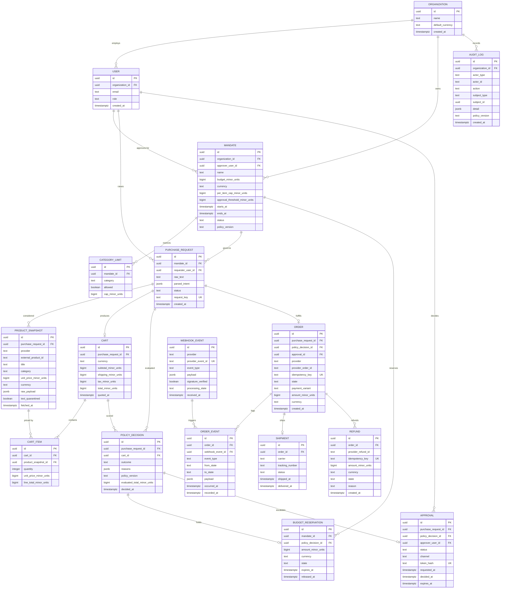

# Data model: Mandate

Postgres is the source of truth for every entity below; Elasticsearch only mirrors `AUDIT_LOG` for search.
Money is always an integer in minor units plus an ISO currency code, decisions always record the `policy_version` that produced them, and `AUDIT_LOG` and `ORDER_EVENT` are append-only at the grant level.
Concurrent overspend is prevented by a `BUDGET_RESERVATION` row taken under a row lock during the policy check — not by an after-the-fact balance query.

**Related:** [README](../README.md) · [architecture](architecture.md) · [UML](uml.md) · [tech stack](tech-stack.md) · [ADR 0003](adr/0003-postgres-source-of-truth-elastic-mirror.md)

---

## 1. Entity relationship diagram



## 2. Column notes

Only the columns that carry a rule or a constraint worth arguing about. Types are Postgres types.

### ORGANIZATION, USER

| Table.column | Type | Note |
|---|---|---|
| `organization.default_currency` | `text` | ISO 4217. Every money column stores its own currency; this is only the default for new mandates |
| `user.role` | `text` | `requester`, `approver`, `admin`. Approval authority is checked against `mandate.approver_user_id`, not against the role alone |

### MANDATE, CATEGORY_LIMIT

| Table.column | Type | Note |
|---|---|---|
| `mandate.budget_minor_units` | `bigint` | Total spend ceiling. Committed spend plus active reservations must never exceed it |
| `mandate.per_item_cap_minor_units` | `bigint` | Applies to `cart_item.line_total_minor_units`, not to the unit price |
| `mandate.approval_threshold_minor_units` | `bigint` | At or above this cart total, outcome is `NEEDS_APPROVAL` |
| `mandate.policy_version` | `text` | The engine version in force when the mandate was written; decisions record their own version too, so a mid-project engine change is traceable |
| `category_limit.allowed` | `boolean` | `false` is an explicit block, distinct from "no limit configured". Absence of a row means the category is not in the allow-list |

### PURCHASE_REQUEST, PRODUCT_SNAPSHOT

| Table.column | Type | Note |
|---|---|---|
| `purchase_request.raw_text` | `text` | The user's words, stored verbatim for audit and eval replay |
| `purchase_request.parsed_intent` | `jsonb` | Schema-validated LLM output. Stored as data, never re-executed as instructions |
| `purchase_request.request_key` | `text` **unique** | Client-supplied; makes double submit idempotent at the request layer |
| `product_snapshot.unit_price_minor_units` | `bigint` | **The authoritative price.** Every total in the system derives from this column, never from LLM output |
| `product_snapshot.raw_payload` | `jsonb` | Full catalog response, for eval replay and dispute evidence |
| `product_snapshot.text_quarantined` | `boolean` | Records that title and description passed the quarantine step before any LLM call. A `false` here on a row used in a decision is a bug, and the eval suite asserts it never happens |
| `product_snapshot.fetched_at` | `timestamptz` | Drives the price-drift check at capture time |

### CART, CART_ITEM

| Table.column | Type | Note |
|---|---|---|
| `cart.total_minor_units` | `bigint` | `subtotal + shipping + tax`, computed in code. A stored generated column is acceptable; a value supplied by any API caller is not |
| `cart.quoted_at` | `timestamptz` | Quote age; compared against the mandate's drift tolerance before capture |
| `cart_item.line_total_minor_units` | `bigint` | `unit_price * quantity`. Recomputed and asserted on write |
| `cart_item.quantity` | `integer` | Positive. A plausibility ceiling is a policy rule, not a column constraint, so that a block produces a *reason* rather than a 500 |

### POLICY_DECISION, BUDGET_RESERVATION

| Table.column | Type | Note |
|---|---|---|
| `policy_decision.outcome` | `text` | `ALLOW`, `NEEDS_APPROVAL`, `DENY` |
| `policy_decision.reasons` | `jsonb` | Array of `{code, message, ruleId, severity}`. Machine-readable so the dashboard and the eval harness read the same thing the user sees |
| `policy_decision.policy_version` | `text` | **Recorded on every decision.** Without it, eval results from different days are not comparable |
| `policy_decision.evaluated_total_minor_units` | `bigint` | The exact total the engine saw; compared against the capture amount |
| `budget_reservation.state` | `text` | `HELD`, `RELEASED`, `COMMITTED` |
| `budget_reservation.expires_at` | `timestamptz` | A reservation that outlives its approval window is swept and released by a job |

### APPROVAL, ORDER

| Table.column | Type | Note |
|---|---|---|
| `approval.token_hash` | `text` **unique** | Only the hash is stored. Single-use: marked used on first redemption |
| `approval.expires_at` | `timestamptz` | Enforced server-side, not by the link |
| `order.idempotency_key` | `text` **unique** | Generated before the first money-moving call and reused on every retry of that same logical capture |
| `order.provider_order_id` | `text` | Needed to reconcile an `UNKNOWN_OUTCOME` via get-order |
| `order.payment_variant` | `text` | `PREAUTH_CAPTURE` or `APPROVAL_LINK`. Recorded per order because which one is available is `VERIFY`; eval results are reported per variant |
| `order.state` | `text` | Mirrors the state machine in [uml.md](uml.md#2-order-state-machine) |

### ORDER_EVENT, WEBHOOK_EVENT

| Table.column | Type | Note |
|---|---|---|
| `order_event.from_state` / `to_state` | `text` | Both recorded, so an illegal or out-of-order transition is visible rather than inferred |
| `order_event.occurred_at` vs `recorded_at` | `timestamptz` | Provider time vs our time. Out-of-order delivery is detected by comparing them |
| `webhook_event.provider_event_id` | `text` **unique** | **The dedupe mechanism.** Redelivery hits a unique violation and is acknowledged without reprocessing |
| `webhook_event.signature_verified` | `boolean` | An unverified event is stored for forensics and never processed |
| `webhook_event.processing_state` | `text` | `RECEIVED`, `PROCESSED`, `FAILED`, `IGNORED` |

### SHIPMENT, REFUND, AUDIT_LOG

| Table.column | Type | Note |
|---|---|---|
| `shipment.status` | `text` | Simulated in sandbox. The README states this plainly |
| `refund.idempotency_key` | `text` **unique** | Refunds move money too, so they carry the same guarantee as captures |
| `audit_log.actor_type` | `text` | `user`, `agent`, `system`, `webhook`. Distinguishing agent actions from human ones is the point of the log |
| `audit_log.detail` | `jsonb` | Includes decision reasons for blocked attempts, which is what the dashboard renders |
| `audit_log.policy_version` | `text` | Lets an auditor replay why a decision was made under the rules of that moment |

## 3. Design rules

### Money

| Rule | Why |
|---|---|
| Every amount is `bigint` minor units plus a `text` ISO currency column | Floats lose cents; a bare number loses the currency. This is hard rule 4 in [CLAUDE.md](../CLAUDE.md) |
| Mixed-currency carts are rejected at intake, not reconciled later | Conversion at decision time would make the policy engine impure and the audit trail arguable |

### Unique constraints that carry correctness

| Constraint | Protects against |
|---|---|
| `order.idempotency_key` **unique** | Double capture from a retry or a double submit |
| `refund.idempotency_key` **unique** | Double refund |
| `webhook_event.provider_event_id` **unique** | Duplicate webhook processing |
| `purchase_request.request_key` **unique** | Duplicate request creation before an order exists |
| `approval.token_hash` **unique** | Token replay |

Dedupe lives in the database constraint, not in application memory, so it survives restarts and multiple instances.

### Append-only tables

`AUDIT_LOG` and `ORDER_EVENT` are insert-only. This is enforced by grants, not convention:

```sql
-- intent, not final migration code
REVOKE UPDATE, DELETE ON audit_log, order_event FROM mandate_app;
GRANT INSERT, SELECT ON audit_log, order_event TO mandate_app;
```

Corrections are expressed as new rows (a compensating event), never as edits. If the application role cannot delete audit rows, an application bug — or a compromised LLM path — cannot erase its own tracks.

### Policy versioning

Every `POLICY_DECISION` stores `policy_version` and its `reasons` JSONB. Consequences:

- Eval runs are comparable only within a policy version; the runner records the version alongside the metrics.
- A reviewer can replay any historical decision against the engine version that produced it.
- Reason codes are stable identifiers (`PER_ITEM_CAP_EXCEEDED`, `CATEGORY_NOT_ALLOWED`, `STRUCTURING_SUSPECTED`, `THRESHOLD_EXCEEDED`, `BUDGET_EXHAUSTED`, `QUANTITY_IMPLAUSIBLE`, `PRICE_DRIFT`); the message is for humans, the code is for machines.

### Concurrency: budget reservations

Two requests arriving at once must not both pass a budget check that only one of them fits. A read-then-write balance check cannot prevent this; a reservation row under a lock can.

```sql
-- intent, not final migration code
BEGIN;
  SELECT id, budget_minor_units
    FROM mandate
   WHERE id = $1
     FOR UPDATE;                      -- serializes concurrent checks on this mandate

  SELECT COALESCE(SUM(amount_minor_units), 0)
    FROM budget_reservation
   WHERE mandate_id = $1
     AND state IN ('HELD', 'COMMITTED');

  -- policy engine evaluates with budget, already-reserved, cart total, now

  INSERT INTO budget_reservation (mandate_id, policy_decision_id, amount_minor_units,
                                  currency, state, expires_at)
       VALUES ($1, $2, $3, $4, 'HELD', now() + interval '24 hours');
COMMIT;
```

| Lifecycle point | Reservation transition |
|---|---|
| Policy check returns `ALLOW` or `NEEDS_APPROVAL` | insert `HELD` |
| Policy check returns `DENY` | no reservation created |
| Approval rejected or expired, or order `FAILED` | `HELD` → `RELEASED` |
| Capture confirmed | `HELD` → `COMMITTED` |
| `expires_at` passes with no resolution | swept by a job: `HELD` → `RELEASED`, with an audit entry |
| Order in `UNKNOWN_OUTCOME` | reservation stays `HELD` until reconciliation decides |

Invariant: `SUM(reservation WHERE state IN ('HELD','COMMITTED')) <= mandate.budget_minor_units`, enforced inside the locked transaction. This is also the mechanism that defeats the structuring attack in the eval suite — many small requests still contend for the same lock and the same reserved total.

### Elasticsearch mirror

| Aspect | Rule |
|---|---|
| Direction | One-way: Postgres → Elasticsearch, `AUDIT_LOG` only |
| Purpose | Search and the "have we bought this before?" lookup |
| Authority | None. Elasticsearch is never read to make a policy or payment decision |
| Failure | A failed mirror write is logged and retried; it never fails the user request ([failure mode 8](architecture.md#5-failure-modes)) |
| Rebuild | The index is reconstructible from `audit_log` at any time |

### Eval results are files, not rows

Eval outputs live in `packages/evals/results/` as committed files, not in the database:

- They are review artifacts and belong in the diff, where a teammate can see a regression in a PR.
- They must survive a database reset, which happens freely during development.
- They are the evidence behind the README's claims, so they need to be versioned with the code and the `policy_version` that produced them.

### Seed data for demos

A deterministic seed script makes the demo and the video repeatable.

| Seed | Content |
|---|---|
| Organization | One org, currency `USD` |
| Users | One treasurer/approver, two requesters |
| Mandate | Budget 50000 minor units, per-item cap 15000, approval threshold 10000, active for the demo window |
| Category limits | `office_supplies` allowed, `electronics` allowed with a cap, `gift_cards` explicitly blocked |
| Product snapshots | Fixture catalog including at least one listing carrying an injection payload, clearly labeled as a test fixture |
| History | A few completed orders so the dashboard is not empty and structuring detection has something to work against |
| Not seeded | Credentials of any kind. The seed script reads sandbox config from the environment |

The seed must be idempotent — rerunning it must not duplicate rows or inflate committed spend.
