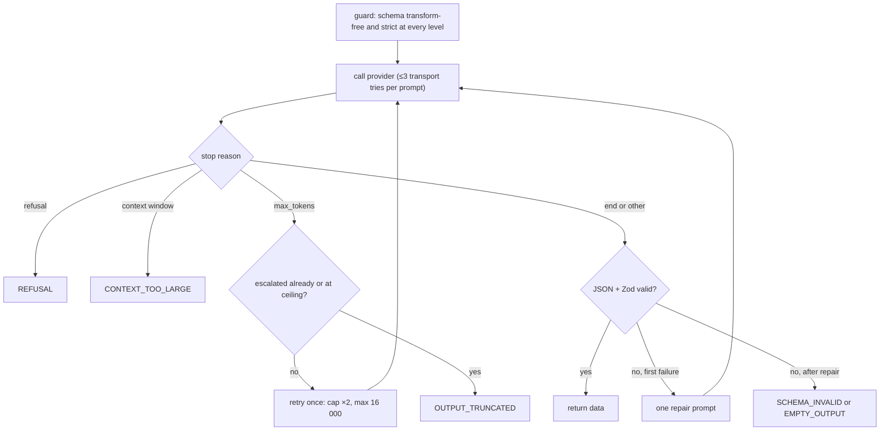

# LLM layer: contract

The LLM layer turns trusted instructions plus quarantined third-party text into **schema-validated data**. It has no tool-calling surface, so a model can never move money.
`packages/shared` owns money, schemas and untrusted-text quarantine. `packages/llm` owns the provider adapter, prompt rendering, the structured-output client, retries, errors, config and logging.
This document is the contract that Phases 2 to 8 build on. Where it diverges from the earlier design docs, §13 lists the divergence for team review.

**Related:** [ADR 0004](adr/0004-llm-has-no-tools-policy-in-code.md) · [architecture](architecture.md) · [UML](uml.md) · [ER diagram](er-diagram.md) · [tech stack](tech-stack.md) · [CLAUDE.md](../CLAUDE.md)

---

## 1. Invariants and how each is enforced

| Invariant | Enforced by | Proven by |
|---|---|---|
| No tool-calling surface | `ProviderRequest` has no `tools`, `tool_choice`, `functions` or sampling fields; the Anthropic adapter copies fields one by one and never spreads the request | `types.test.ts` (compile-time); `anthropic.test.ts` smuggles `tools` and `temperature` in at runtime and asserts they are not sent |
| Only validated output leaves the layer | `LlmClient` parses JSON and validates with the caller's strict Zod schema before returning | `client.test.ts` (invalid, malformed, empty and extra-field replies) |
| Untrusted text is typed | `Quarantined<string>` brand; only `quarantineText()` creates one; lint bans `as Quarantined` outside `quarantine.ts`, and `as never` everywhere | `types.test.ts` (`@ts-expect-error`); `tests/lint-guards.test.ts` |
| Prompt text, model output and keys never reach logs or error messages | `Logger` fields carry metadata and a SHA-256 only; error messages are fixed strings | canary tests in `client.test.ts`, `anthropic.test.ts`, `config.test.ts` |
| Retries are bounded | ≤3 calls per prompt, ≤4 calls total, one overall deadline, enforced even against an adapter that hangs | `client.test.ts` cap and deadline tests |
| Money is integer minor units | `MoneySchema` (safe integer ≥ 0, ISO alpha-3); BigInt arithmetic; non-integer factors rejected | `money.test.ts` |
| The layer cannot reach payments or policy | Runtime dependencies are allow-listed; imports are checked against an allow-list plus forbidden patterns (`paypal`, `apps/`, `packages/policy`, `@mandate/evals`) | `boundary.test.ts` |
| Source is ASCII-only (no invisible "Trojan Source" characters) | Write `\u` escapes; never paste literal invisible characters | `tests/source-hygiene.test.ts` |

## 2. Interfaces

```ts
// packages/llm/src/provider.ts: transport only
interface ProviderRequest {
  system: string;
  userText: string;
  maxOutputTokens: number;
  timeoutMs: number;                              // time left in the caller's overall deadline
  signal?: AbortSignal;
  responseJsonSchema?: Record<string, unknown>;   // native structured output (not a tool)
}
interface ProviderResponse { text: string; usage: Usage; model: string; stopReason: StopReason }
type StopReason = 'end' | 'max_tokens' | 'refusal' | 'context_window_exceeded' | 'other';
interface ProviderAdapter { readonly provider: string; readonly model: string; complete(r: ProviderRequest): Promise<ProviderResponse> }

// packages/llm/src/client.ts: everything else
class LlmClient {
  constructor(o: { adapter; timeoutMs; maxOutputTokens; maxOutputTokensCeiling?; logger?; clock?; sleep?; random?; nonceSource? });
  generateStructured<S extends z.ZodType>(r: {
    schemaName: string; schema: S; system: string; parts: readonly PromptPart[];
    timeoutMs?: number; maxOutputTokens?: number; signal?: AbortSignal;
  }): Promise<{ data: z.output<S>; usage: Usage; attempts: number; model: string; latencyMs: number }>;
}

// packages/llm/src/prompt.ts
type PromptPart = { kind: 'trusted'; text: string } | { kind: 'untrusted'; label: string; text: Quarantined<string> };

// packages/shared/src/quarantine.ts
function quarantineText(raw: unknown, opts?: { maxCodePoints?: number }): { text: Quarantined<string>; flags: QuarantineFlags };
```

Typical use (Phases 3 and 4):

```ts
const client = new LlmClient({ adapter: AnthropicAdapter.fromConfig(config), timeoutMs: config.timeoutMs, maxOutputTokens: config.maxOutputTokens, logger });
const { data } = await client.generateStructured({
  schemaName: 'proposal',
  schema: ProposalSchema,
  system: RANKING_INSTRUCTIONS,                                   // trusted, owned by Phase 4
  parts: [
    { kind: 'trusted', text: requestSummary },
    { kind: 'untrusted', label: 'candidate_title', text: candidate.title },  // already Quarantined via CandidateSchema
  ],
});
```

## 3. Schemas (`packages/shared`)

All model-facing schemas use `z.strictObject` at every level, so extra fields are rejected.

| Schema | Shape | Notes |
|---|---|---|
| `MoneySchema` | `{ amountMinor: safe int ≥ 0, currency: /^[A-Z]{3}$/ }` | `addMoney` and `multiplyMoney(m, qty)` use BigInt and throw `MoneyError` on `OVERFLOW`, `CURRENCY_MISMATCH` and `INVALID_FACTOR`. A fractional factor is rejected because minor units cannot be rounded |
| `PurchaseIntentSchema` | `{ schemaVersion: '1', items[≤20]: { description 1..200, quantity 1..10 000, category?, maxUnitPrice?: Money, neededBy?: ISO date }, clarifications[≤5], needsClarification }` | It is either items, or a clarification request with at least one question |
| `ProposalSchema` | `{ selections[≤20]: { candidateId, quantity 1..10 000, reason 1..300 }, unmatchedItems[≤20]: { itemIndex, reason } }` | No prices, no totals (ADR 0004). A repeated `candidateId` or a repeated `itemIndex` is rejected. `reason` is model-written text, so treat it as untrusted wherever it is shown or reused |
| `CandidateSchema` | `{ id, sourceProductId, retailer, unitPrice: Money, url, fetchedAt (ISO), title, description }` | **Not model-facing.** `retailer`, `title` and `description` pass through `quarantineText` as a transform, so the parsed type is `Quarantined<string>`; `retailer` and `title` must keep some text after quarantine. `url` is https only, rejects credentials (`https://shop.example@evil.example` opens evil.example) and is stored in canonical `URL.href` form. Because of that transform it cannot be exported as JSON Schema, and `LlmClient` rejects it as a response schema |

The quantity cap of 10 000 is a sanity bound, not a plausibility rule. Per the ER doc, an implausible quantity is a *policy reason*, so an injected "buy 10" must reach the policy engine and be denied with a reason rather than fail schema validation.

### Mapping to `PRODUCT_SNAPSHOT` (ER doc)

| `CandidateSchema` | `PRODUCT_SNAPSHOT` | Status |
|---|---|---|
| `id` (opaque `cand_…`) | `id uuid` | **Differs.** The model sees short opaque ids, never database ids. Phase 4 resolves `candidateId` to a snapshot row |
| `sourceProductId` | `external_product_id` | **Name differs** |
| `unitPrice.amountMinor` / `unitPrice.currency` | `unit_price_minor_units` / `currency` | **Name and shape differ** (`amountMinor` vs `*_minor_units`) |
| `retailer` | none (`provider` is the catalog provider, e.g. Channel3) | **Missing column** |
| `url` | none (inside `raw_payload`) | **Missing column** |
| `description` | none | **Missing column** |
| `title` | `title` | Matches; stored quarantined |
| `fetchedAt` | `fetched_at` | Matches |
| (always quarantined) | `text_quarantined boolean` | Always `true` by construction |
| none | `category`, `raw_payload`, `purchase_request_id` | Set by Phase 2 normalization |

## 4. Quarantine pipeline

`quarantineText(raw, { maxCodePoints = 2000 })` runs in this order:

| # | Step | Detail |
|---|---|---|
| 1 | Coerce | `null`/`undefined` → `''`; objects → `JSON.stringify` (throwing values → `''`); lone surrogates → U+FFFD |
| 2 | NFKC | Maps compatibility forms first, so a fullwidth `＜` becomes `<` before step 5 replaces it |
| 3 | Strip | U+2028, U+2029, CRLF and CR become `\n`; strips C0 except `\t` and `\n`, DEL, C1, zero-width and format characters (U+00AD, U+180E, U+200B–U+200F, U+2060–U+2064, U+FEFF), bidi controls (U+061C, U+202A–U+202E, U+2066–U+2069), and tag characters U+E0000–U+E007F |
| 4 | HTML | Removes comments (an unterminated `<!--` removes the rest) and tags, keeping inner text. **Best-effort; not a security boundary** |
| 5 | Angle brackets | `<` → `‹`, `>` → `›`. Untrusted text can therefore never forge a delimiter tag |
| 6 | Collapse | 3+ newlines → 2; trim |
| — | Re-compose | A second NFKC re-composes sequences that stripping brought together (e.g. `e` + U+200B + U+0301 → `é`), which is what makes the function idempotent |
| 7 | Truncate | By code points, with the ASCII marker ` [truncated]` counted inside the limit. U+2026 is avoided because NFKC maps it to `...` |

`flags`: `truncated`, `strippedControl` (controls, zero-width and format), `strippedBidi`, `strippedTagChars`, `strippedHtml`, `injectionHeuristic`.

**`injectionHeuristic` is telemetry only and never a security control.** It is a lexical regex for phrases such as "ignore previous instructions" or "skip approval". It does not change the text, it is trivially evaded, and nothing may gate behaviour on it.

**Order evidence (exhaustive scan, Node 22.21, Unicode 16.0, all 1,112,064 scalar values):**

- NFKC never maps a non-forbidden code point into the forbidden set.
- NFKC leaves all 216 forbidden code points unchanged.
- Only U+FE64, U+FE65, U+FF1C and U+FF1E map to `<` or `>`.

Consequences:

- Swapping steps 2 and 3 is an *equivalent mutant*: no input distinguishes it, given the final re-compose step.
- Running NFKC *after* step 5 is a real bug, and a test catches it.

## 5. Prompt rendering

```
<untrusted_data id="<32 hex nonce>" label="<label>">
<quarantined text>
</untrusted_data id="<same nonce>">
```

- The 16-byte nonce comes from an injectable `NonceSource`, `crypto.randomBytes` by default.
- Every provider call re-renders the prompt, so every call gets fresh nonces.
- If the text already contains the nonce (case-insensitive), a new one is drawn. After 8 collisions the call throws `NonceExhaustedError`.
- Labels must match `/^[a-z][a-z0-9_]{0,31}$/`.
- When any part is untrusted, the client appends a fixed notice to the system prompt describing the block format. That notice describes the format; it is not the defense, which is that the call has no tools and its output is schema-checked.

## 6. Structured output and retry policy



| Rule | Value |
|---|---|
| Calls per `generateStructured` | at most **4**, whatever the reason |
| Transport calls to deliver one prompt (initial, repair or escalation) | at most **3** |
| Retryable transport errors | `PROVIDER_TIMEOUT`, `PROVIDER_RATE_LIMITED`, `PROVIDER_UNAVAILABLE` |
| Backoff | full jitter: `random() × min(4000, 250 × 2^(n-1))` ms |
| `Retry-After` | honoured exactly (`retry-after-ms`, seconds, or HTTP date; a blank header counts as absent). If the wait would cross the deadline, the call fails now rather than sleeping |
| Deadline | one overall `timeoutMs`. Each call gets the remaining time, and the client races the adapter so a hung adapter still times out |
| Abort | checked before each call and during backoff, and raced against the adapter → `ABORTED` |
| Stop reason | checked **before** parsing: truncated or refused output is never accepted, even when it parses |
| Repair prompt | the original prompt (fresh nonces) plus a summary of Zod issue codes and paths. No values or messages; unknown keys are counted, not named (the model chose them); the previous model output is never re-sent |
| Usage | summed across every call that returned |

**Native structured output.** The Anthropic adapter sends `output_config.format = { type: 'json_schema', schema }`, not a tool. The SDK helper `transformJSONSchema` moves keywords the API does not enforce (minimum, maximum, maxLength, pattern, `minItems > 1`) into descriptions. **The API therefore guarantees shape, not bounds; the Zod validation in `LlmClient` is authoritative.**

**Response schema requirements.** A response schema must be transform-free: Zod's output-mode JSON Schema export throws on transforms. It must also be strict at every level. Strictness is checked on the **input-mode** export, because output mode marks even a plain `z.object` as closed. Violations throw `SchemaNotSupportedError` before any provider call.

## 7. Errors

| Code | Retryable | Raised when |
|---|---|---|
| `SCHEMA_INVALID` | no | invalid JSON or Zod failure, after the one repair |
| `EMPTY_OUTPUT` | no | an empty reply, after the one repair |
| `REFUSAL` | no | stop reason `refusal` (no automatic fallback model; see §13) |
| `OUTPUT_TRUNCATED` | no | `max_tokens` after one escalation, or at the ceiling |
| `CONTEXT_TOO_LARGE` | no | stop reason `model_context_window_exceeded`; HTTP 413; HTTP 400 "prompt is too long" (`VERIFY`) |
| `PROVIDER_TIMEOUT` | yes | connection timeout, 408, or the overall deadline |
| `PROVIDER_RATE_LIMITED` | yes | 429 |
| `PROVIDER_UNAVAILABLE` | yes | 5xx (including 529 overloaded), 409, connection error |
| `PROVIDER_AUTH` | no | 401, 403 |
| `PROVIDER_BAD_REQUEST` | no | any other 4xx |
| `ABORTED` | no | the caller's `AbortSignal` |

Every `LlmError` has `code`, `retryable`, `attempts`, `status` and `requestId`, and a fixed message that never contains prompt text, model output or provider payloads. Programming errors are separate classes: `SchemaNotSupportedError`, `NonceExhaustedError`, `LlmConfigError`. Any non-SDK exception from an adapter is a bug, so it propagates unchanged and is not retried.

## 8. Logging

`Logger` is `{ debug, info, warn, error }(message, fields)`. To use pino, adapt it as `(m, f) => pino.info(f, m)`.

| Event | Level | Fields |
|---|---|---|
| `llm.attempt` | debug | provider, model, schema, attempt, phase (`initial`/`repair`/`escalation`), promptSha256, systemChars, userChars, maxOutputTokens |
| `llm.result` | info on success, warn on failure | provider, model, schema, attempts, outcome (`OK` or the error code), latencyMs, inputTokens, outputTokens, promptSha256 (of the first prompt), outputChars |

`promptSha256` is the SHA-256 of the system prompt, a fixed separator and the rendered user text. **Never logged:** prompt text, model output, keys.

## 9. Configuration

`loadLlmConfig(env = process.env)` is the **only** reader of LLM configuration and of the key. It reads only the object it is given.

| Variable | Default | Rule |
|---|---|---|
| `LLM_PROVIDER` | `anthropic` | `anthropic` is the only provider today |
| `LLM_MODEL` | `claude-opus-5-5` | `[A-Za-z0-9._:-]{1,100}` |
| `ANTHROPIC_API_KEY` | none (required) | held in a `Secret`: `toJSON`, `toString` and `util.inspect` all print `[REDACTED]`; only `reveal()` returns it |
| `LLM_TIMEOUT_MS` | `60000` | integer, 1 000–120 000 |
| `LLM_MAX_OUTPUT_TOKENS` | `8192` | integer, 256–16 000. Opus 5.5 always thinks, and thinking counts toward this budget |

Empty values, as copied from `.env.example`, count as unset. A `LlmConfigError` lists variable **names** only, never values.

**SDK environment isolation.** `createAnthropicClient` pins every option the SDK would otherwise read from the environment:

| SDK env var | Neutralized by |
|---|---|
| `ANTHROPIC_API_KEY` / `ANTHROPIC_AUTH_TOKEN` | passing `apiKey` explicitly and `authToken: null` (the SDK does not consult env when a credential is passed in code) |
| `ANTHROPIC_BASE_URL` | explicit `baseURL: https://api.anthropic.com` (prevents redirecting the key elsewhere) |
| `ANTHROPIC_LOG` | `logLevel: 'off'` (debug level can print request bodies, i.e. prompt text) |
| `ANTHROPIC_OPEN_TELEMETRY*` | `openTelemetry: false` (content capture would export prompt text) |
| (SDK retries) | `maxRetries: 0`, on the client and per request, so `LlmClient`'s bounds are the only retries |
| `ANTHROPIC_CUSTOM_HEADERS` | **cannot be disabled through options.** Deployments must not set it (§12) |

## 10. Why the adapter never sends `temperature`, `top_p` or `top_k`

- **Primary source:** Anthropic, *Migrating to API version 2026-10-21*, <https://platform.claude.com/docs/en/api/migration-2026-10-21>: *"In `2026-10-21`, a request that sends `temperature`, `top_p`, or `top_k` returns a 400 error, even at the parameter's default value."* The same page lists `@anthropic-ai/sdk` **1.0.0** as the first TypeScript release that uses `2026-10-21`. We pin 1.3.0.
- **Installed SDK:** the 1.3.0 `MessageCreateParams` type has no `temperature`, `top_p` or `top_k` field (observed in `node_modules/@anthropic-ai/sdk/resources/messages/messages.d.ts`).
- **Live probe:** `pnpm smoke:live` sends `temperature: 0.5` through the raw SDK and asserts a `BadRequestError`. **Not yet run:** no key was available in the development shell, so the claim is sourced but **not live-verified** (`VERIFY`). Run it with `ANTHROPIC_API_KEY` exported and record the result here.

Removing sampling control does not remove determinism control. The layer's correctness never depended on low temperature: every output is validated, and the policy engine decides.

## 11. Adding a provider

1. Implement `ProviderAdapter` in `src/adapters/<name>.ts`. It is transport only: map `ProviderRequest` to the SDK by picking fields one by one (never spread), use native structured output if the SDK has it, disable SDK retries, and pass `timeoutMs` and `signal` through.
2. Map SDK failures to `ProviderError` codes. Return non-SDK errors unchanged, and never put provider messages into errors.
3. Map stop reasons to `StopReason`, and return only text blocks as `text`.
4. Add the SDK to `ALLOWED_DEPENDENCIES` in `test/import-boundary.ts`, extend `LLM_PROVIDER` in `config.ts`, and pin every env default the SDK reads.
5. Add adapter tests with a mocked transport and the real SDK error classes, including a "smuggled `tools` is not sent" test.

The Phase 5 naive baseline needs tools. It belongs in `packages/evals` with its own adapter, never in `packages/llm`. `boundary.test.ts` forbids `@mandate/evals` imports.

## 12. Known limits and VERIFY

| Item | Status |
|---|---|
| Sampling-parameter rejection, live | `VERIFY`: sourced (§10), not yet observed live |
| Native structured output with `claude-opus-5-5` end to end | `VERIFY`: run `pnpm smoke:live` |
| 400 "prompt is too long" wording for CONTEXT_TOO_LARGE | `VERIFY` against a real oversized request |
| `ANTHROPIC_CUSTOM_HEADERS` | merged by the SDK unconditionally; must not be set in any deployment |
| Zero-width joiner stripped | breaks emoji ZWJ sequences into separate emoji (acceptable for product text) |
| Spaces are not collapsed | removing a comment can leave a double space |
| HTML removal | best-effort only; never a security control |
| `injectionHeuristic` | telemetry only; trivially evaded |
| `quarantineText` input size | not capped internally; `CandidateSchema` caps raw text at 100 000 code units, and other callers must bound input |
| Generic-cast laundering | the lint guard catches direct casts to `Quarantined` and any `as never`, not a hand-written generic identity function; reviewers watch for one |

## 13. Interface decisions needing team review

| # | Decision | Why |
|---|---|---|
| 1 | **Multi-item `PurchaseIntent` (`items[]`)** | The UML `PurchaseIntent` has a single `normalizedGoal`; real requests hold several items. It persists in `purchase_request.parsed_intent` jsonb |
| 2 | **Source-first internal packages** (`exports` → `src/index.ts`, no build step) | Simplest for Vitest and tsc. The runtime build for `apps/api` is Phase 6's call |
| 3 | `ProviderRequest` adds `responseJsonSchema?` and `ProviderResponse` adds `stopReason`; `temperature` removed | R1 needs native structured output; refusals and truncation must be detected before parsing; the API rejects sampling parameters |
| 4 | Error codes `PROVIDER_BAD_REQUEST` and `OUTPUT_TRUNCATED` added | Other 4xx responses and max_tokens stops need honest codes |
| 5 | Retry bounds read as "≤3 calls per prompt, ≤4 total, one deadline"; repair and escalation share the budget | Makes "3 transport, 4 total" precise |
| 6 | Repair re-sends the original prompt plus a codes-and-paths summary only | A repair needs the context; it must never echo model output or model-chosen key names |
| 7 | `retailer` is quarantined too | It is retailer-controlled text, like title and description |
| 8 | ER field mismatches (§3) | Phase 2 or the ER doc should converge on names |
| 9 | Refusal fallback off | Keeps the three-configuration eval reproducible: no silent model switch |
| 10 | Defaults `LLM_MAX_OUTPUT_TOKENS=8192`, `LLM_TIMEOUT_MS=60000` | Opus 5.5 thinking cannot be disabled and consumes output budget. Tune `effort` in Phase 7 |
| 11 | `CandidateSchema` rejects a candidate whose `title` or `retailer` is empty after quarantine, or whose `url` has credentials | The ranker needs something to identify a candidate by, and a link must open the shop it names. Phase 2 drops (and should count) such candidates |

## 14. Commands

| Command | What it runs |
|---|---|
| `pnpm test` | all unit, property, type, boundary, lint-guard and hygiene tests, with coverage. Thresholds of ≥90% lines and branches on `packages/llm/src`, `shared/src/quarantine.ts` and `shared/src/money.ts` fail the run |
| `pnpm typecheck` | `tsc` for root and packages; this is what checks every `@ts-expect-error` |
| `pnpm lint` | typed ESLint, including the Quarantined/never cast guards |
| `pnpm smoke:offline` | full client path against the fake provider and the real schemas (CI) |
| `pnpm smoke:live` | one real structured call plus the sampling probe. Without `ANTHROPIC_API_KEY`, or under `CI`, each test prints `SKIPPED: …` and reports **skipped**, never passed. Vitest still labels the file "passed", so read the test lines. Export the key in your shell: nothing loads `.env` automatically |

## 15. What later phases build on

| Phase | Uses |
|---|---|
| 2: Channel3 client | `CandidateSchema` (quarantine on parse), `MoneySchema`, opaque `cand_…` ids, the ER mapping in §3 |
| 3: intent parser | `LlmClient.generateStructured` + `PurchaseIntentSchema`; the user's request as a trusted or untrusted part (Phase 3's decision) |
| 4: ranker | `ProposalSchema`; candidate text as `untrusted` parts; resolve `candidateId` to a snapshot and recompute prices in code |
| 5: evals | `FakeProvider` with fault injection; a tools-enabled naive adapter kept in `packages/evals` |
| 6: orchestrator | the `LlmError` codes → user-facing states; a pino adapter for `Logger`; `loadLlmConfig` at startup |
| 7: tuning | `effort`, token budget and timeout from measurements; held-out attacks never used for prompt tuning |
